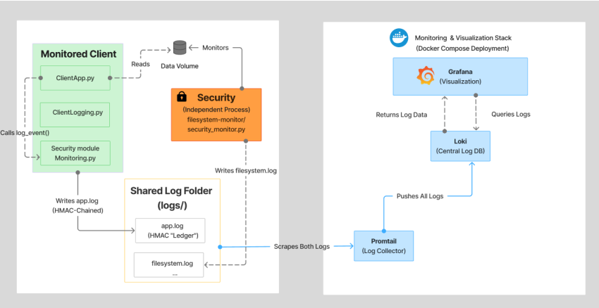
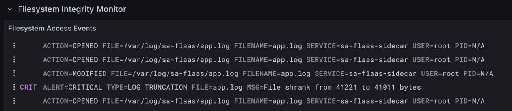

# SecurityMonitor

**Built for privacy. Designed for accountability.**

*A security monitoring and auditing prototype for federated learning, developed as part of my 2025 Bachelor's thesis at Turku University of Applied Sciences.*

> **Repository status:** This repository currently documents the prototype and provides integration/configuration examples. The complete runnable SA-FLaaS source tree and referenced files are **not** included here. The instructions below describe the original project environment; they are not a standalone installation guide for this repository.

## Overview

SecurityMonitor was designed for **Secure and Accurate Federated Learning as a Service (SA-FLaaS)**. It explores a challenge in privacy-preserving AI: how can a federated learning system verify what a client claims to have done without relying exclusively on the client's own application logs?

The prototype focuses on **tampering** and **repudiation** risks identified through STRIDE threat modeling. It correlates two evidence streams:

1. **Internal ledger:** HMAC-chained records of application-reported actions such as `training_started` and `training_ended`.
2. **Independent sidecar monitor:** Filesystem observations gathered using **Watchdog + polling**, including modifications, deletions, and potential log truncation.

Events are brought together through **Promtail, Loki, and Grafana** to support investigation of discrepancies, such as a client reporting a training run without corresponding observed activity.

**Scope:** This is a detective-control prototype, not a model-poisoning prevention system or proof of regulatory compliance. HMAC chaining makes recorded changes detectable when verification keys and trusted reference information are appropriately protected; it does not make logs inherently immutable or guarantee non-repudiation.

## System Architecture



*Figure 1. Original prototype architecture: client-side audit logging, independent filesystem monitoring, and centralized observability using Promtail, Loki, and Grafana.*

The independent monitor is intended to provide a second perspective on client activity. Its independence depends on deployment boundaries and host/container permissions; an attacker with sufficient host-level control may compromise both sources.

## Key capabilities

| Capability | Purpose |
| --- | --- |
| HMAC-chained event log | Detect modification of recorded client-reported events during verification |
| Independent sidecar | Observe filesystem activity separately from the client application |
| Hybrid Watchdog + polling | Improve visibility when Docker bind mounts do not reliably propagate filesystem events |
| Centralized observability | Collect and visualize events with Promtail, Loki, and Grafana |
| Correlation timeline | Compare application claims with sidecar observations to flag inconsistencies |

## Prototype evaluation

### Log integrity detection



*Figure 2. Filesystem integrity monitoring identifies a log truncation event and emits a critical alert.*

My thesis documents a **Fake Training** anomaly scenario and a **log-integrity alert**, alongside screenshots of the correlation timeline and monitoring dashboard (Chapter 5, *Prototype Monitoring Tool*). These demonstrations show the prototype's intended detection workflow under the evaluated conditions; they do not establish comprehensive detection coverage.

## Original project layout

The original SA-FLaaS integration referenced the following paths. **They are not currently available as separate files in this repository.**

```text
MVD/src/monitoring.py              # Internal security ledger
filesystem-monitor/
  Dockerfile
  security_monitor.py             # Independent sidecar monitor
monitoring-stack/
  docker-compose.yml              # Loki, Promtail, Grafana, sidecar
  promtail-config.yaml
  datasources.yaml
  saf-dashboard.json
```

## Integration reference

The following snippets document how the prototype was integrated in its original environment. They are **illustrative extracts**, not a complete runnable application.

### 1. Instrument client lifecycle events

Install the original Python dependency in the appropriate project environment:

```bash
pip install watchdog
```

The client application uses the event helper:

```python
from MVD.dashboard.clientLogging import send_client_monitoring_events

@app.train(action="simulation")
def train(msg: Message, ctx: Context):
    send_client_monitoring_events(
        event_name="training_started",
        client_id=str(app.node_id),
        extra_data={
            "message_type": msg.metadata.message_type,
            "run_id": str(ctx.run_id),
        },
    )

    # Original application training logic runs here.

    send_client_monitoring_events(
        event_name="training_ended",
        client_id=str(app.node_id),
        extra_data={"status": "success", "run_id": str(ctx.run_id)},
    )
    # Return the result required by the original application.
```

Evaluation events follow the same pattern (`evaluation_started`, `evaluation_ended`). In a production implementation, event completion and failure should be handled explicitly so errors do not create misleading audit records.

### 2. Original Docker Compose example

This example documents the original monitoring stack's components and volume mounts. It assumes the surrounding SA-FLaaS directory structure and referenced configuration files exist.

> **Security note:** Do not deploy the example unchanged to an exposed or production environment. Set a strong Grafana admin password, disable anonymous access unless explicitly required, restrict published ports, secure Loki ingestion, and review log-data permissions. The values below reflect a local development setup.

```yaml
services:
  loki:
    image: grafana/loki:2.9.2
    ports:
      - "3100:3100"
    command: -config.file=/etc/loki/local-config.yaml
    networks: [monitoring-net]

  promtail:
    image: grafana/promtail:2.9.2
    volumes:
      - ./promtail-config.yaml:/etc/promtail/config.yml
      - ../logs:/var/log/sa-flaas
    command: -config.file=/etc/promtail/config.yml
    networks: [monitoring-net]

  grafana:
    image: grafana/grafana:latest
    ports:
      - "3000:3000"
    volumes:
      - ./datasources.yaml:/etc/grafana/provisioning/datasources/ds.yaml
      - grafana_data:/var/lib/grafana
    environment:
      - GF_SECURITY_ADMIN_PASSWORD=admin  # DEMO ONLY — change this
      - GF_AUTH_ANONYMOUS_ENABLED=true    # DEMO ONLY — disable for production
    depends_on: [loki]
    networks: [monitoring-net]

  security:
    build:
      context: ../filesystem-monitor
      dockerfile: Dockerfile
    user: "${UID}:${GID}"
    command: >
      python -u security_monitor.py
      --watch-dir /project_root
      --log-file /var/log/sa-flaas/filesystem.log
    volumes:
      - ../:/project_root:ro
      - ../logs:/var/log/sa-flaas
    networks: [monitoring-net]

volumes:
  grafana_data:

networks:
  monitoring-net:
```

**Linux/WSL permissions in the original environment:**

```bash
cd monitoring-stack
printf 'UID=%s\nGID=%s\n' "$(id -u)" "$(id -g)" > .env
docker compose up -d
```

On Windows with WSL2, the original workflow used Docker Desktop with WSL integration enabled. On macOS, Docker Desktop was used; native Linux uses Docker Engine and the Compose plugin. The `.env` user/group mapping shown above is Unix-specific and may need adjustment on other hosts.

### 3. Dashboard reference

In the original environment, Grafana was available at `http://localhost:3000`. The dashboard was imported from `monitoring-stack/saf-dashboard.json`.

Its views included:

- **Security Correlation Timeline:** application events versus filesystem observations.
- **Session Information:** run context such as user, PID, and script.
- **Client Audit Trail:** application-reported events and their integrity-verification context.
- **Sidecar Observations:** filesystem events recorded independently.

Timeline alignment is an investigative signal, **not proof that a training run was benign or that the model update was safe**.

### 4. Cross-platform monitoring

Docker bind-mounted filesystem events can behave differently across host platforms. The original design combined event-driven Watchdog monitoring with periodic polling to help catch changes that event propagation may miss, particularly deletions on Windows/macOS Docker hosts. Polling also provides redundancy on Linux, at additional resource cost.

The sidecar accepted these arguments:

```text
--watch-dir  Directory to observe (example: /project_root)
--log-file   Output log path (example: /var/log/sa-flaas/filesystem.log)
```

### 5. Multi-machine deployment considerations

For deployments where the monitoring backend and clients run on different machines, the original setup required each client's Promtail configuration to send logs to the server's Loki endpoint. This must be adapted with network access controls and authenticated/encrypted transport before use outside a trusted lab. A standalone sidecar is needed on each monitored client host.

## Security and limitations

- This project supports **detection and auditability**, not prevention of model poisoning.
- A filesystem event does not prove that training computations occurred or that an update was trustworthy.
- HMAC verification requires secure key management and trusted verification procedures.
- Host-level compromise, incomplete event coverage, log loss, and time synchronization can affect findings.
- The prototype was evaluated in a specific research environment and is **not a production-ready compliance solution**.
- Its design is relevant to traceability and monitoring discussions under the **EU AI Act**, **GDPR**, and standards such as **ISO/IEC 27001** and **ISO/IEC 42001**; no certification or legal compliance is claimed.

## Academic background

**Bachelor's thesis (2025)**  
*Federated Learning with Sensitive Data – A Cybersecurity Analysis and Implementation of a Security Monitoring System*  
Turku University of Applied Sciences · Business Information Technology

The thesis combines a review of regulatory requirements, STRIDE threat modeling of SA-FLaaS, design and implementation of the prototype, and evaluation of the monitoring approach.

*Add the official thesis publication URL here when available.*

## Image files

For the images above to display on GitHub, upload `Diagram_.png` and `LogIntegrity.png` to the **same repository directory as `README.md`**.

## Publication note

This repository is currently private. Before publishing the original implementation or research artifacts, confirm that any SA-FLaaS code, architecture details, sample logs, and third-party materials may be shared under the project's permissions.

---

*Security engineering at the intersection of privacy-preserving AI, threat modeling, and verifiable monitoring.*
